<picture>
  <source media="(prefers-color-scheme: dark)" srcset="assets/banner-dark.svg">
  
</picture>

  
  
  

I build ML systems that run on real sensor data: streaming pipelines, fault diagnosis models, and the dashboards on top of them. Final-year B.Tech in Computer Science (Data Science) at VNR VJIET, Hyderabad, graduating 2027.

**Looking for:** AI / ML / data engineering roles and 2027 internships in Hyderabad, Bangalore or remote.

### What I've built

| | |
|---|---|
| **Artha Solutions** · SDE intern, 2025 | Digital twin of an industrial cement roller press (Unity 3D), an OPC-UA → Kafka → InfluxDB streaming pipeline, XGBoost / Random Forest fault models, and a LangGraph RAG assistant for SQL generation. |
| **[Motor fault diagnosis research](https://github.com/Kirthan156/induction-motor-fault-diagnosis)** | Metaheuristic feature selection on 2.1M sensor samples. 82.7% fewer features at macro F1 0.9998. Accepted at an international conference. |
| **[Predictive maintenance](https://github.com/Kirthan156/Major-motor-predictive-maintainence)** | ESP32-S3 sensor node → MQTT → live anomaly detection dashboard. |
| **[Food calorie estimator](https://github.com/Kirthan156/Cal_AI)** | ConvNeXt-Tiny fine-tuned on Food-101, 87% top-1, served with Flask + React. |

### Stack

### Activity

<picture>
  <source media="(prefers-color-scheme: dark)" srcset="assets/stats-dark.svg">
  
</picture>
<picture>
  <source media="(prefers-color-scheme: dark)" srcset="assets/languages-dark.svg">
  
</picture>

<picture>
  <source media="(prefers-color-scheme: dark)" srcset="https://raw.githubusercontent.com/Kirthan156/Kirthan156/output/snake-dark.svg">
  
</picture>

Banner, cards and snake are generated by a GitHub Action in this repo and refresh daily.
